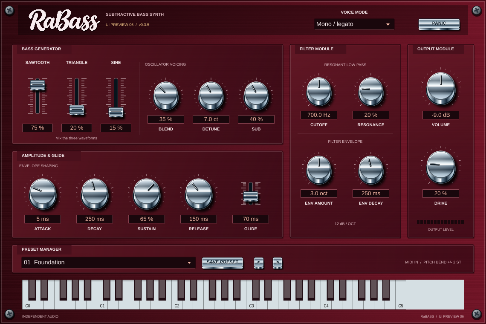

# RaBASS 0.3.7 — Windows VST3 Installer

**Subtractive synthesis bass synth** za Windows 10/11 x64, u **VST3** formatu.
CMake projekt za Visual Studio 2026 i MIDI trake u Ableton Liveu 12.
Isporuka je **standardni Windows Setup.exe instaler za VST3** i izvorni projekt.
Instalira se samo VST3 instrument, bez standalone aplikacije.

Probni UI ima tamnocrvenu brušenu metalnu podlogu, manje kromirane potenciometre
s višim reljefom i izraženijim sjenama, kromirane ručice klizača te uže i
nešto više tipke. Dimenzije su 1140 × 760. Područja za povlačenje kontrola
ostaju dovoljno velika za rad mišem.
Paneli, izbornici, polja s vrijednostima i oznake koriste usklađenu
tamnocrvenu paletu; kromirane kontrole i njihov reljef ostaju sačuvani.
Naziv **RaBass** u zaglavlju sada je rukopisni logotip sa spojenim slovima,
u svijetloj boji na tamnocrvenoj podlozi. Logotip je ugrađen u plugin pa
ne zahtijeva instalaciju dodatnog fonta.
Oscilatori, filter, envelope, output i preseti imaju zaseban prostor.
Izbornik preseta ima odjeljke **Factory presets** i **User presets**,
kompaktnu kromiranu tipku s **ikonom diskete** za spremanje te tipke za
prethodni/sljedeći preset. Ikona je vektorska i ugrađena u plugin.
DSP engine i izvornih šest tvorničkih zvukova nisu mijenjani.
Prethodna [stabilna verzija 0.2.0](https://github.com/voyagersquare/RaBASS/releases/tag/v0.2.0)
ostaje dostupna dok isprobavamo novi izgled.



## Oscilatori i miks

**SAWTOOTH**, **TRIANGLE** i **SINE** imaju nezavisne razine od 0 do 100 %.
Možete koristiti svaki val samostalno ili ih miješati u bilo kojem omjeru.
Miks ulazi u postojeći rezonantni low-pass filter, zatim u amplitude ADSR
te izlazni stupanj. Filter envelope otvara cutoff do šest oktava.

- SAWTOOTH daje bogat spektar za klasični subtractive bass.
- TRIANGLE dodaje mekše, uglavnom neparne harmonike.
- SINE daje temeljni ton za čišći bass.

BLEND i DETUNE zadržavaju svoju ulogu: BLEND miješa osnovnu i detuniranu
kopiju odabranog timbra, a DETUNE određuje razliku njihove visine.
SUB je zaseban sinusni oscilator oktavu niže. Kada su sva tri glavna vala
na 0 %, SUB i dalje može svirati; za potpunu tišinu spustite i SUB na 0 %.
Razine miksera imaju kratko zaglađivanje, a zbroj iznad 100 % normalizira
se radi prostora u izlaznom signalu.

## Precizniji Filter Cutoff

Cutoff se povlačenjem miša podešava četiri puta postupnije, a kotačićem
miša deset puta finije. **Shift + kotačić** daje dodatnih deset puta manji
pomak. Tipke sa strelicama mijenjaju cutoff za **1 Hz**, a uz Shift za
**0,1 Hz**. Polje uvijek prikazuje Hz s jednom decimalom; za izravan unos
možete upisati Hz ili kHz. Raspon 30–18000 Hz, mapiranje automatizacije,
kratko DSP zaglađivanje i spremljeni preseti ostaju sačuvani.

## Ostale funkcije

- Postojeći filter, resonance, filter envelope i njegov decay.
- Amplitude ADSR, drive i output; 2x interno uzorkovanje oscilatora i filtera.
- Mono s prioritetom zadnje note, legatom i glideom ili osam glasova.
- MIDI velocity, pitch bend ±2 polutona, sustain CC64 i PANIC.
- 18 tvorničkih bass preseta: izvornih šest plus 12 novih kombinacija.
- Spremanje i učitavanje vlastitih preseta na disk, dostupnih u svim instancama.
- Automatizacija razina sva tri vala i ostalih aktivnih kontrola.
- Spremanje parametara u DAW projekt, mono/stereo izlaz i miš-klavijatura.

U mono načinu povezane note ne pokreću envelope ponovno. Otpuštanje zadnje
note vraća prethodnu još pritisnutu notu. Glide 0 isključuje klizanje.
Lijevi i desni kanal identični su radi centriranog basa.

## Preuzimanje i Ableton Live 12

Preuzmite `RaBASS-0.3.7-Windows-x64-Setup.exe` iz
[Windows VST3 Installer izdanja](https://github.com/voyagersquare/RaBASS/releases/tag/v0.3.7-installer-preview.1).
Paket je dostupan i u **Actions → Windows VST3 installer → uspješan run → Artifacts**.
Releases uključuje izvore RaBASS-a i JUCE-a, `SHA256SUMS.txt` i rezultate
provjere instalacije u `installer-test-results.json`.

1. Zatvorite Ableton Live i ostale DAW aplikacije.
2. Pokrenite **Setup.exe**, potvrdite administratorsko odobrenje i dovršite
   standardni čarobnjak za instalaciju.
3. Instaler postavlja cijelu mapu `RaBASS.vst3` u
   `C:\Program Files\Common Files\VST3\RaBASS.vst3`.
4. U Liveu otvorite Settings → Plug-Ins i uključite
   **Use VST3 Plug-In System Folders**.
5. Kliknite **Rescan**, pronađite RaBASS i dodajte ga na **MIDI traku**.

Instaler podržava nadogradnju postojeće ručno kopirane VST3 verzije i
zadržava izvorni identitet RaBASS Windows instalacije. Prije nadogradnje
zatvorite aplikacije koje koriste plugin. Ne instalira standalone program
ni prečace na radnu površinu ili u Start izbornik.
Na odredišnom računalu nisu potrebni Visual Studio, dodatni runtime download
ni internetska veza.

Za uklanjanje otvorite **Windows Settings → Apps → Installed apps → RaBASS →
Uninstall**. Korisnički preseti u AppData mapi ostaju sačuvani.
Dokumentacija i licence nalaze se u
`C:\Program Files\Independent Audio\RaBASS`.

## User presets i novi bass zvukovi

1. Podesite zvuk i kliknite **ikonu diskete** uz padajući izbornik.
2. Unesite naziv i kliknite **Save**. Spremljeni zvuk odabire se u izborniku.
3. U padajućem izborniku otvorite **User presets** i odaberite svoj zvuk.

Nazivi mogu imati do 64 znaka. Ako naziv već postoji, plugin traži potvrdu
prije zamjene postojećeg preseta. Spremanje ne prekida notu koja svira.
Preset obuhvaća sve postavke zvuka, uključujući tri vala, filter, ADSR,
mono/poly, glide, sub, drive i output.

Na Windowsu se `.rabasspreset` datoteke čuvaju u:
`%APPDATA%\Independent Audio\RaBASS\Presets`.
Za sigurnosnu kopiju prenesite cijelu tu mapu. Novi preseti dostupni su i
nakon ponovnog pokretanja Livea; druge otvorene instance osvježavaju popis
kad otvorite izbornik. Projekt sprema zvuk i naziv čak i ako preset datoteka
na drugom računalu nije dostupna. Oštećene datoteke ne učitavaju se.

Novi tvornički preseti:

- Round Finger, Saw Punch, Triangle Pluck, Sine Weight.
- Warm Circuit, Acid Snap, Long Slide, Dub Foundation.
- Grit Bass, Hollow Motion, Tight Sequence, Poly Brass.

## Build u Visual Studiju 2026

Potrebni su **Desktop development with C++**, Windows SDK,
**C++ CMake tools for Windows** i Git for Windows.

1. Klonirajte repozitorij, primjerice u `C:\Dev\RaBASS`.
2. Pokrenite `Build-Windows.cmd`: automatski pronalazi najnoviji VS s x64
   C++ alatima preko vswhere, koristi Ninja i pokreće testove.
3. Za izradu instalera instalirajte **Inno Setup 6.7.4** s
   https://jrsoftware.org/isdl.php, zatim pokrenite:

```powershell
.\Build-Installer.cmd -SkipBuild
```

Bez `-SkipBuild` naredba prvo gradi VST3 i pokreće testove.
Za prilagođenu lokaciju Inno compilera koristite
`Installer/Build-Installer.ps1 -IsccPath "C:\putanja\ISCC.exe"`.
Build koristi samo JUCE format `VST3`; standalone cilj nije uključen.

Alternativno otvorite mapu u VS 2026, odaberite CMake preset `windows-x64`
i cilj `RaBASS_VST3`. Koristite x64 toolchain.
JUCE 8.0.6 fiksiran je na commit `51a8a6d7aeae7326956d747737ccf1575e61e209`.
MSVC runtime statički je uključen u plugin.

VST3 izlaz: `build/windows-x64/RaBASS_artefacts/Release/VST3/RaBASS.vst3`.
Setup.exe, izvorne arhive, manifest i SHA256 provjere: `build/packages`.

## Stariji projekti i provjere

Stanja iz 0.1.0 učitavaju se uz zadržavanje filtera, envelopes, suba, detunea
te ostalih parametara. Stari Saw prelazi u Sawtooth, Triangle u Triangle,
a Pulse u približan Sawtooth/Triangle miks. Zvuk stare Pulse postavke zato
neće biti identičan. Nova automatizacija valova koristi tri zasebne razine;
stara automatizacija izbora Waveform više ne upravlja timbrom.

Testovi pokrivaju svaki val samostalno, njihov miks, mutiranje, zasebni sub,
tuning, MIDI, mono prioritet, sustain, polifoniju, razne sample rateove,
spremanje novih razina, obnovu starih stanja i ponovno otvaranje editora.
Provjeravaju i da su sve kontrole unutar prozora te da se međusobno ne
preklapaju i da ih oznake ne zaklanjaju.
Testovi User Presets provjeravaju spremanje, ponovno učitavanje, zamjenu,
rad u novoj instanci, DAW recall, neispravne datoteke i odjeljke izbornika.
Windows workflow koristi fiksiranu verziju Inno Setup 6.7.4, provjerava
SHA256 compilera i izrađuje instalacijski EXE. Na zasebnom Windows runneru
provjerava čistu instalaciju, hash svake instalirane VST3 datoteke, ponovnu
instalaciju, nadogradnju ručno kopiranog plugina, zapis u Installed apps,
izostanak standalone aplikacije, deinstalaciju i očuvanje korisničkih preseta.
Instalacijski smoke testovi namijenjeni su samo tom privremenom CI runneru.

DSP testovi bez JUCE-a:

```sh
cmake -S . -B build/dsp -DRABASS_DSP_ONLY=ON -DCMAKE_BUILD_TYPE=Release
cmake --build build/dsp
ctest --test-dir build/dsp --output-on-failure
```

Stvarni Ableton Live 12 i lokalni Visual Studio 2026 trebaju i provjeru na
korisnikovom Windows računalu: scan, playback, automation i save/reopen.

## Licence

Izvorni RaBASS kod: **CC0-1.0**; vidi [LICENSE](LICENSE).
Kombinirani JUCE plugin koristi JUCE-ovu **AGPLv3** opciju i pripadajuće
licence ovisnosti. CC0 ne mijenja JUCE-ove uvjete. Izvori RaBASS-a i JUCE-a
isporučuju se uz Windows instaler. Zatvorena distribucija kombiniranog plugina
zahtijeva odgovarajuću komercijalnu JUCE licencu.
